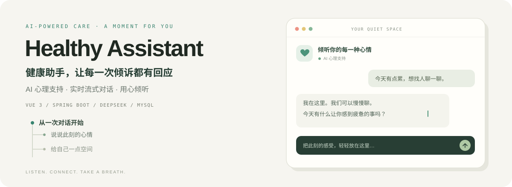

# Healthy Assistant · 健康助手

<p align="center"></p>

基于 Vue 3 与 Spring Boot 的健康助手项目，包含心理支持对话、用户认证及相关前端页面。

## 项目内容

- 用户注册、登录、JWT 身份认证和当前用户信息接口。
- 心理咨询会话创建，通过 SSE 接收 AI 流式回复。
- 前端包含咨询、情绪日记、知识文章和管理页面；页面对应的全部接口尚未在当前后端中提供。
- AI 使用 OpenAI 兼容接口，示例配置为 SiliconFlow 的 DeepSeek-V3 模型。

## 技术栈

| 模块 | 技术 |
| --- | --- |
| 前端 | Vue 3、Vite、Element Plus、Pinia、Vue Router、Axios、ECharts |
| 后端 | Java 17、Spring Boot、Spring AI、Spring Security、MyBatis Plus |
| 数据库 | MySQL |
| 通信 | REST API、Server-Sent Events（SSE） |

## 目录结构

```text
healthy-assistant/
├── ai-spingboot/           # Spring Boot 后端（保留原目录名称）
│   ├── src/main/java/      # 接口、业务逻辑、实体和配置
│   ├── src/main/resources/
│   │   └── application.example.yml
│   └── pom.xml
├── ai-vue/                 # Vue 前端
│   ├── src/                # 页面、组件、路由与接口封装
│   ├── public/
│   └── package.json
└── README.md
```

## 本地运行

### 1. 准备环境

安装 JDK 17、支持 Vite 7 的 Node.js（建议 22.12 或更高版本）和 MySQL。Maven 可使用项目自带的 Wrapper。

当前仓库没有数据库初始化 SQL 或迁移脚本。启动前需要根据后端实体及业务需求准备 `mental_health_assistant` 数据库和表结构。

### 2. 配置并启动后端

在仓库根目录执行以下 PowerShell 命令（首次克隆时）：

```powershell
Copy-Item ai-spingboot/src/main/resources/application.example.yml ai-spingboot/src/main/resources/application.yml
$env:DB_PASSWORD = '替换为数据库密码'
$env:AI_API_KEY = '替换为模型服务 API Key'
$env:JWT_SECRET = '替换为随机生成的长密钥'
cd ai-spingboot
.\mvnw.cmd spring-boot:run
```

按实际环境调整 `application.yml` 中的数据库地址、用户名、模型和服务地址。后端默认监听 `1236` 端口。macOS/Linux 可使用 `./mvnw spring-boot:run`，并按所用 Shell 设置对应环境变量。

本地 `application.yml` 已加入忽略规则，仓库只保存使用环境变量的配置示例。

### 3. 配置并启动前端

本地联调前，将 `ai-vue/vite.config.js` 中 `/api` 的代理目标改为 `http://localhost:1236`。同时检查 `ai-vue/src/config/index.js` 的文件服务地址及页面中直接使用的接口地址，按部署环境调整。

在新终端执行：

```powershell
cd ai-vue
npm ci
npm run dev
```

打开 Vite 启动输出中显示的地址。

### 4. 构建

```powershell
# 在 ai-vue 目录执行
npm run build

# 在 ai-spingboot 目录执行
.\mvnw.cmd package
```

后端构建中的测试可能需要数据库及模型服务配置。上述步骤是运行说明，本次仓库整理未验证完整构建或端到端运行。

## 已有核心接口

| 方法 | 路径 | 用途 |
| --- | --- | --- |
| POST | `/api/user/add` | 注册 |
| POST | `/api/user/login` | 登录 |
| GET | `/api/user/current` | 当前用户信息 |
| POST | `/api/psychological-chat/session/start` | 创建咨询会话 |
| POST | `/api/psychological-chat/stream` | 流式咨询回复 |

请求参数和认证要求请以对应 Controller、DTO 及安全配置为准。

## 仓库说明

已排除本地敏感配置、依赖目录、编译产物和 IDE 缓存。请勿提交 API Key、数据库密码或 JWT 密钥。

